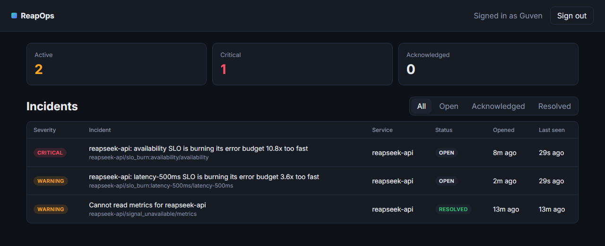
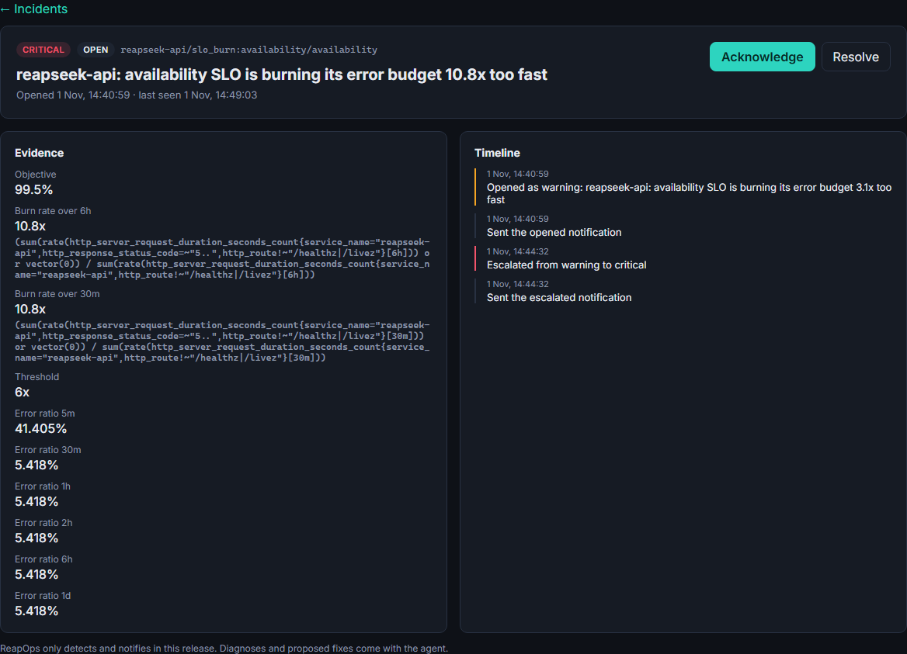

# ReapOps

[](https://github.com/guvenimat/ReapOps/actions/workflows/ci.yml)
[](LICENSE)

An agentic operations control plane for Kubernetes. ReapOps detects incidents with SLO burn rates, rules and
statistics, asks an LLM agent to explain them with evidence and propose fixes from a fixed action catalog, and
applies a fix only after a human approves it, through Git pull requests and Argo CD.

Read the [specification](docs/spec.md) and the [decision records](docs/adr).



## Status

| Milestone | State |
|---|---|
| 1. Kubernetes foundation (the watched system on k3d with Helm, HPA, quotas, Kyverno, Argo CD) | done, in [ReapSeek](https://github.com/guvenimat/ReapSeek/tree/main/deploy/k8s) |
| 2. Detect and notify: SLO burn rates, workload rules, incidents, email, console, no actions | **done** |
| 3. Read-only agent: diagnosis in shadow mode, evaluation set | agent core, tools, policy and eval set done; model adapter next |
| 4. Capacity actions: `CapacityOverride` CRD and controller, approvals, verification | planned |
| 5. Code fixes: pull requests, canary deploys, rollback | planned |

## What works today

- **SLO burn rates.** Each service declares SLOs with a PromQL error-ratio template; the worker evaluates multi-window burn rates
  (14.4x over 1 h and 5 min, 6x over 6 h and 30 min: critical; 3x over 1 day and 2 h: warning) every 30 seconds.
- **Anomalies.** A metric is compared with the same time of day over the previous seven days: median, MAD-based robust score,
  and a minimum real change (50% by default) so that statistically odd but harmless wiggles stay quiet. Nothing is judged until
  a metric has five days of history. ReapSeek watches its request rate (both ways) and paid orders per minute (drops only).
- **Workload rules.** From the Kubernetes API with a read-only service account: an autoscaler at its ceiling, crash loops,
  and OOM kills or repeated restarts in the last 15 minutes.
- **Incidents.** One open incident per fingerprint (service, kind, key). A worse reading escalates it; it resolves itself only after
  the condition has stayed clear for 10 minutes. If a signal source cannot be read, ReapOps opens an incident about that and keeps
  the incidents that depend on it open instead of resolving them blindly.
- **Notifications.** Email on open, escalation and resolution, held during maintenance windows and capped at 20 per hour
  (resolutions always go out). Every decision is on the incident's timeline.
- **Console.** Incident list and detail with the evidence, the exact PromQL behind each number, and the timeline; operators can
  acknowledge or resolve. Sign-in is a console password with an HMAC-signed, HttpOnly, SameSite=Strict session cookie.



Tested against ReapSeek on a local cluster by stopping its search engine under load: the availability SLO incident opened as a
warning, escalated to critical within four minutes as the 30-minute window caught up, a latency SLO warning followed from the
timeouts, and an earlier "cannot read metrics" incident resolved itself once Prometheus had been reachable for ten minutes.

## The diagnosis agent

When an incident opens or escalates, the agent gets a brief (the detection evidence) and three read-only tools: `query_metrics`
(PromQL now or in the past), `workload_status` (autoscalers and pod states of a watched namespace) and `incident_history`. It
submits one structured diagnosis: summary, root cause, confidence, evidence claims that cite the tool calls they come from, the
hypotheses it ruled out, and at most three options from the action catalog.

Guardrails are code, not prompt text:

- Tool output is redacted (passwords, tokens, keys, emails, phone and card numbers) and wrapped as `<tool_output>` data.
- `DiagnosisPolicy` drops options outside the catalog or with unknown parameters, drops claims that cite no tool call from the
  run, and lowers confidence when nothing is grounded. A low-confidence diagnosis is escalated rather than presented as an answer.
- Step and token budgets end a wandering run. Architecture tests check that no agent tool depends on a write port.
- New behaviour starts in **shadow mode**: diagnoses are stored and visible in the console, labelled as not reviewed, and never
  sent in notifications.

The evaluation set in [`eval/cases`](eval/cases) replays recorded tool outputs for four situations where the obvious answer is
wrong in some of them: a search engine outage (scaling would not help), a bot flood (traffic up, orders flat), real demand on a
campaign day (here scaling is right), and a memory leak after a deploy. `ReapOps.Worker eval eval/cases` scores the first option,
forbidden options, root-cause terms and grounding per case.

## Architecture

Clean Architecture ([ADR 0008](docs/adr/0008-clean-architecture.md)), enforced by architecture tests:

| Project | Contains |
|---|---|
| `ReapOps.Domain` | `Incident` aggregate and its state machine, `Slo` and `BurnRatePolicy`, `WorkloadRules`, `NoisePolicy`; no packages |
| `ReapOps.Application` | Use cases (`DetectIncidents`, `AcknowledgeIncident`, `ResolveIncident`), queries, and ports: `IMetricsReader`, `IClusterReader`, `IIncidentReader`, `IIncidentStore`, `INotifier`, `IClock` |
| `ReapOps.Infrastructure` | Adapters: Prometheus and Kubernetes API (plain `HttpClient`, Native AOT friendly), PostgreSQL with Dapper.AOT, SMTP |
| `ReapOps.Worker` | Detection loop and migrations |
| `ReapOps.Api` | Console API and the React console (`web/`) as static files |

Both hosts are published with Native AOT. Read and write ports are separate interfaces; the detection namespace cannot reference adapters.

## Running it

ReapOps runs next to the system it watches. With the ReapSeek cluster from its `deploy/k8s/up.ps1` running:

```powershell
cd deploy
.\up.ps1            # builds images, imports them into k3d, creates secrets in deploy/.env, registers the Argo CD application
.\up.ps1 -Local     # or install the chart from the working tree with Helm
```

The console is at http://ops.localhost:8080; the password is `CONSOLE_PASSWORD` in `deploy/.env`. What to watch is configuration
only (`monitoring` in `deploy/chart/reapops/values.yaml`): service names, namespaces and SLO queries.

## License

Apache 2.0, see [LICENSE](LICENSE).
